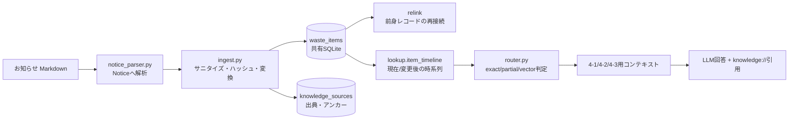

# STAGE 04 — 現行構築・検証記録

Team B / Teamb4  
基準日: 2026-09-09  
対象ブランチ: `feat/pij-defense`  
対象コミット: `9403cda`  
STAGE 04 コア実装の基準コミット: `d921022`

> この文書は、既存の設計・分担文書を残したまま、現在の STAGE 04 の構築方法と検証契約を整理するための現行版である。コードの変更履歴を上書きしないため、過去の文書は削除・改訂せず、歴史資料として保持する。

## 1. 既存文書の有無と最新版判定

| 文書 | 役割 | 最終更新の目安 | 現在の扱い |
|---|---|---:|---|
| [`STAGE04_取り込み仕様.md`](STAGE04_取り込み仕様.md) | お知らせの解析・DB取り込み・新旧リンクの設計 | 2026-09-08 15:34 | **データ取り込み部分は有効**。後半の 4-3 説明と未決事項は旧仕様 |
| [`STAGE04_分担提案.md`](STAGE04_分担提案.md) | 初期の担当分け・引き渡し案 | 2026-09-08 | **計画・履歴**。4-3 の「断り書き」「未着手」などは現行動作を表さない |
| [`data_schema.md`](data_schema.md) | 共有 DB の基本スキーマ | 2026-09-08 | `is_current` / `effective_from` / `superseded_by` の定義は現行でも使用 |
| [`CONTEXT.md`](CONTEXT.md) | プロジェクト全体の用語・構成 | 2026-09-08 | 概要として有効。STAGE 04 の最新の採点ルールまでは記載されていない |

したがって、**STAGE 04 に関する文書自体は存在するが、単独で最新版と言える文書はこれまで無かった**。特に `STAGE04_分担提案.md` に残る「4-3 は類似品を示したうえで固定の確認文を返す」という説明は、#36・#37 の実装後には正しくない。本書を現行版として参照する。

## 2. STAGE 04 の目的と入力

STAGE 04 は、早見表を一度検索するだけでなく、採点中に追加される「お知らせ」を構造化して、次の三つを回答に反映する機能である。

| 要件 | 入力 | 回答上の目的 |
|---|---|---|
| 4-1 | 早見表に無い新しい品目の追加通知 | 通知の回収方法をその品目の回答根拠にする |
| 4-2 | 既存品目の変更通知 | 現在の規則、切替日、切替後の規則を同時に案内する |
| 4-3 | 早見表に個別記載が無い品目 | 指定された類似品の根拠から分別区分を導く |

配布ファイルは通常、次の二つである。

- `knowledge/incoming/お知らせ-4-1.md`: 追加通知 15 件
- `knowledge/incoming/お知らせ-4-2.md`: 変更通知 15 件

ファイル名だけで種類を決めず、本文に `現行（早見表）の…扱いは…まで有効` という節があるかで変更通知を判定する。このため、将来一つのファイルに追加通知と変更通知が混在しても、通知単位で分類できる。

## 3. 現行の構築フロー



### 3.1 解析層: `app/notices/notice_parser.py`

`## お知らせ NN: 品目` 単位で Markdown を分割し、`Notice` に変換する。主な処理は以下である。

1. 見出し、本文、発行元、アンカーを抽出する。
2. `2026年10月から` のような適用開始日を `effective_from` に変換する。
3. `現行（早見表）の…扱いは2026年9月まで有効` を検出し、変更通知の前身区分と旧有効期限を取り出す。
4. 旧区分を新ルール本文から除外する。これにより回答側が旧文を新ルールとして引用しない。
5. 通知本文の SHA-256 を作り、同じ通知の再取り込みを検知できるようにする。

解析層はファイル・DB・ネットワークに依存しない純粋なテキスト処理として実装されている。

### 3.2 取り込み層: `app/notices/ingest.py`

`Notice` を共有モデル `app.data.schema.WasteItem` に変換し、クローラーが使用する DB と同じ `var/kitakyushu_waste.db` に書き込む。独自の `waste_items` テーブルを作らず、STAGE 02/03 のデータ層を再利用する。

| 通知情報 | 保存先 |
|---|---|
| 品目の正規化名 | `waste_items.item_name` |
| 見出しの原文 | `waste_items.item_name_raw` |
| 新しい出し方 | `waste_items.disposal_method` |
| 発行元・旧区分・旧期限 | `waste_items.notes` |
| 通知のローカル根拠 | `waste_items.source_url` (`knowledge://...`) |
| 新ルールの適用開始日 | `waste_items.effective_from` |
| 同じ通知の再取り込み防止 | `knowledge_sources.content_hash` |

配布ファイルは採点中に内容が追加されるため、本文・品名・タイトルを保存時にサニタイズする。指示文らしい文字列が検出されても正当なお知らせ自体は捨てず、警告として運用者に示す。

### 3.3 4-1 と 4-2 のバージョン管理

追加通知 (4-1) は、前身が無ければ `waste_items` に単独行として INSERT する。

変更通知 (4-2) は、既存の現行行を消さず、次の順序で二つの行を併存させる。

1. 取り込み前に `is_current = 1` の前身候補を探す。
2. 新ルールを新しい行として INSERT (`is_current = 1`, `effective_from = 適用開始日`)。
3. 前身行を UPDATE (`is_current = 0`, `superseded_by = 新行の id`)。
4. `version_window()` が後継行の開始日の前日を旧行の終了日として導出する。

クローラーが先に実行されていなかった場合は、通知を `unlinked` として保持し、後から `python -m app.notices.ingest --relink` で前身を接続する。語順違いのベクトル候補は自動リンクせず、人手確認対象として扱う。

### 3.4 回答ルーティング層: `app/rag/router.py`

回答生成前に、質問を次の順で処理する。

1. `_item_name_candidates()` が自然な質問末尾（`どう捨てればいいですか`、`どこで回収してもらえますか` など）を除去する。
2. `_search_item()` が完全一致・部分一致・ベクトル候補を取得する。
3. `_resolve_named_hit()` が、質問文内に実在する品名が助詞境界付きで現れる場合に、汚れた候補文字列を正規の品名へ戻す。
4. 完全一致/部分一致なら、`item_timeline()` と `pending_change()` を使って 4-1/4-2 の根拠を組み立てる。
5. 類似検索 (`vector`) の場合は、4-3 として `_analogy_pick()` が通知由来でない参照品を一件に絞る。
6. `_relation_strength()` と `_analogy_is_reliable()` が品名の語彙的な上位語関係を確認し、候補選択を安定させる。

## 4. 現行の要件別動作

### 4.1 4-1: 追加通知

- 通知品目は単独レコードとして保存する。
- 自然な質問文でも品名を exact/partial に解決する。
- 通知由来の `knowledge://お知らせ-4-1.md#...` を回答根拠にできる。
- 類似品への置き換えや固定拒答には落とさない。

### 4.2 4-2: 変更通知

- 旧行と新行を同時に保持する。
- `effective_from` は新ルールの適用開始日を表す。
- 回答は必ず「現在の規則」→「切替日」→「切替後の規則」の順で説明する。
- 日付は月だけに丸めず、年・月・日まで表記する。
- 変更通知の根拠は通知の `knowledge://` URL に限定し、無関係な早見表 URL を混ぜない。
- 検索結果に無い条件、持込先、申込要否、メタ注記を補完しない。

### 4.3 4-3: 類似品からの分別区分

旧文書にあった「類似品を示した後、常に確認だけ促す」という方針は現行では採用しない。採点フィードバックで「類似品の根拠から区分を導ける場合は、結論を出さない回答が減点」とされたためである。

現行方針は次の通り。

- 質問品そのものを通知品目へ誤変換しない。
- 通知由来の行を類似根拠から除外し、早見表由来の候補を優先する。
- 品名の上位語関係を優先する。例: `ハンドミキサー → ミキサー`、`目覚まし時計 → 時計`。
- ベクトル順位だけで誤った候補を選ばないよう、必要な品目は `_ANALOGY_PREFERRED` で明示する。
- 利用可能な候補がある場合は、その候補の区分を明確に案内し、末尾に公式確認を一言添える。
- 利用可能な候補が一件も無い場合だけ、固定の確認文 (`canned`) を使う。
- 回答本文の参照 URL は選択した一件の根拠に絞る。

現在の回帰契約で固定している代表的な対応は次の通りである。

| 質問品 | 参照品 | 参照区分 |
|---|---|---|
| 小型のモバイルプロジェクター | ビデオカメラ | 小型電子機器 |
| 折り畳み式の小型踏み台 | 緩衝材(プラ製) | プラスチック |
| 電動爪切り | 電動工具 | 粗大ごみ |
| お掃除ロボット | 掃除機 | 粗大ごみ |
| スマートウォッチ | 腕時計 | 小型電子機器 |
| 電動歯ブラシの充電スタンド | 電動歯ブラシ | 小型電子機器 |
| ハンドミキサー | ミキサー | 家庭ごみ |
| 家庭用の電動ミニシュレッダー | シュレッダー(家庭用) | 粗大ごみ・事前申込制 |
| ワイヤレス充電器 | アダプター(電源用) | 小型電子機器 |

全件の質問文と期待参照品は [`tests/stage4_grader_replay_test.py`](../tests/stage4_grader_replay_test.py) および [`tests/fixtures/stage4_grader_replay.json`](../tests/fixtures/stage4_grader_replay.json) を正本とする。

## 5. 検証方法と現在の検証契約

### 5.1 回帰テスト

実際の B1 採点で使われた 50 問を再現し、LLM を呼ばずにルーティングを検証する。

| 対象 | 検証内容 | 契約値 |
|---|---|---:|
| 4-1 | 通知品目が自然な質問文でも exact 解決 | 15 問中 14 問以上 |
| 4-2 | 変更通知が exact 解決し、時間軸処理へ進む | 15/15 |
| 4-3 | 早見表外の品目を exact に誤変換しない | exact 0 件 |
| 4-3 | 利用可能な類似候補から区分を出す | canned 0 件 |

主なテストファイル:

- [`tests/notices_ingest_test.py`](../tests/notices_ingest_test.py): パーサ、取り込み、バージョンリンク、relink
- [`tests/notices_integration_test.py`](../tests/notices_integration_test.py): 4-1/4-2 の DB・ルーター・引用の接続
- [`tests/stage4_grader_replay_test.py`](../tests/stage4_grader_replay_test.py): B1 実プロンプト 50 問のルーティング回帰
- [`tests/notices_eval.py`](../tests/notices_eval.py): データ側の採点風評価

依存関係が揃った環境では、次を実行する。

```bash
python -m pytest tests/notices_ingest_test.py tests/notices_integration_test.py tests/stage4_grader_replay_test.py
python -m tests.notices_eval
```

この作業環境では `pytest` と `pydantic` が未インストールのため、上記テストの実行結果を本書で「合格」とは断定しない。テストコード、fixture、コミット履歴を根拠として、実行可能な環境で再検証する。

### 5.2 実機確認の順序

実機でコードを更新した場合は、次の順序を崩さない。

1. サービスを一度だけ再起動し、対象コミットがロードされたことを確認する。
2. 通常の質問一件で SSE の完了 (`data: [DONE]`) を確認する。
3. 4-1、4-2、4-3 の代表質問を少数だけ確認する。
4. 予熱・代表質問を除外するため、必要なら `var/stage4_trace.jsonl` を空にする。
5. 採点中はコード変更・再起動を行わず、一度だけ採点する。
6. 採点後に分野別得点と実際の回答を照合し、次の修正対象を決める。

## 6. 変更履歴上の重要な修正

| コミット | 目的 |
|---|---|
| `9dece35` (#30) | 4-2 の時系列回答からメタ注記・無関係な引用を除去 |
| `32d94df` (#31) | 4-3 ゲートを vector 段に限定し、ルーティング記録を追加 |
| `0b21788` (#32) | 自然な質問末尾を除去し、4-1/4-2 の誤 vector 落ちを修正 |
| `34eab17` (#33) | 類似候補を語彙関係で選択 |
| `0f5a9ef` / `b687957` (#34/#35) | 上位語判定と修飾語・内容語の境界を厳密化 |
| `284ae4e` (#36) | 類似根拠がある 4-3 は固定拒答せず区分を導く |
| `d921022` (#37) | 修飾語を連続して剥がし、参照 URL を一件に限定、追加映射を固定 |

これらにより、初期の「品名抽出失敗 → 全問 vector → 4-2 時間軸未発火」という回帰と、その後の「4-3 を安全側に倒しすぎて拒答が増える」という回帰を分離して修正できるようになった。

## 7. 文書の更新ルール

1. 4-1/4-2 の入力形式、DB列、リンク規則を変えた場合は `STAGE04_取り込み仕様.md` を更新する。
2. ルーティング、類似品選択、プロンプト、引用形式を変えた場合は本書の §3・§4・§5 と replay fixture を同時に更新する。
3. 分担・計画上の変更は `STAGE04_分担提案.md` に追記する。ただし、実装済みの事実は本書にも反映する。
4. 新しい B1 採点結果を追加するときは、日付、対象コミット、4-1/4-2/4-3 の内訳、未解決ケースを記録する。
5. コードの現状と文書の記述が食い違う場合、先にテストとコミットを確認し、本書の「現行版」を修正する。過去文書の記述を現行仕様として引用しない。

## 8. 結論

- STAGE 04 の既存文書は存在する。
- ただし、既存文書は **データ取り込みの設計としては有効、4-3 と現在のルーティングについては古い**。
- 本書を現行の構築・検証・更新方針の入口とする。
- 今回は文書のみを追加し、アプリケーションコード、DB、サービス設定は変更していない。
